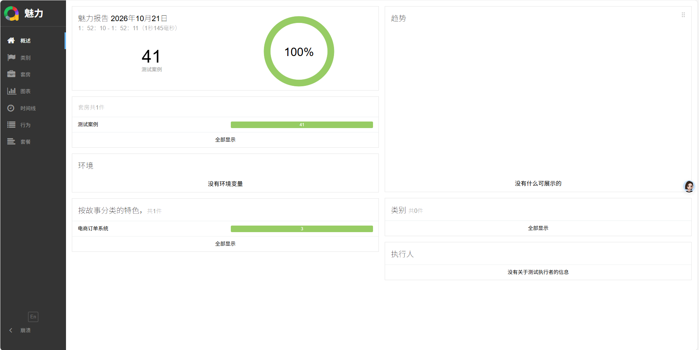
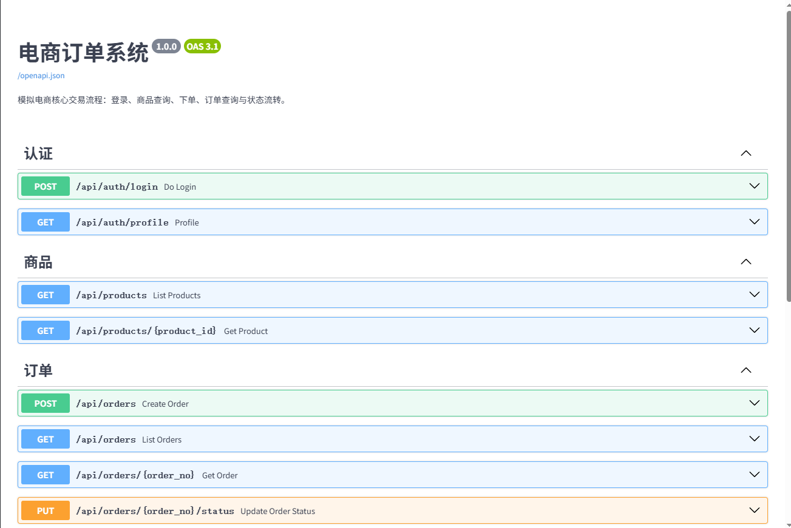
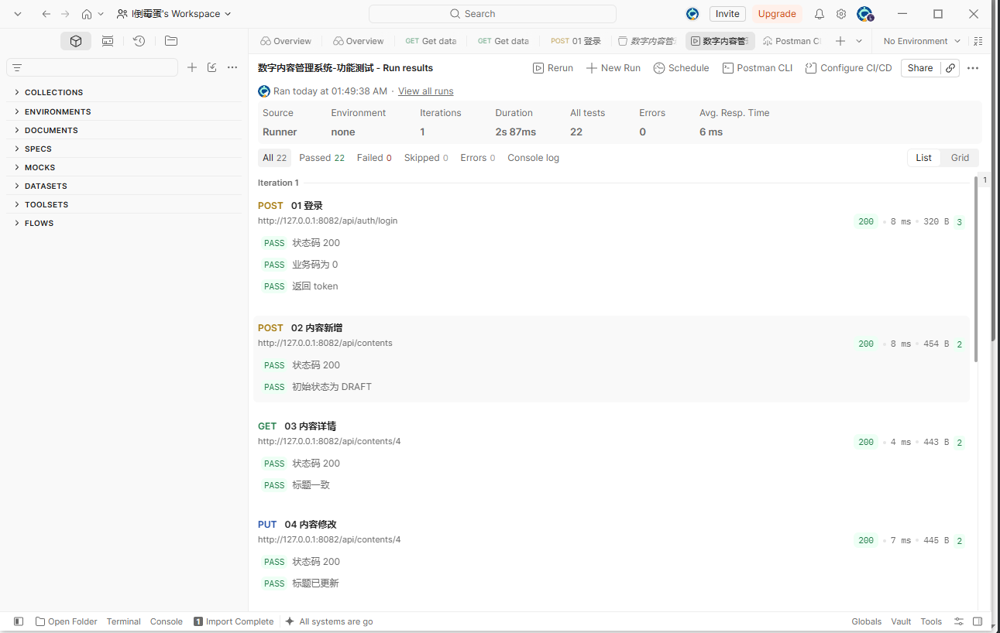

# 软件测试项目集：电商订单系统 & 数字内容管理系统

两个可运行的软件测试实践项目，覆盖 **接口自动化测试** 与 **功能测试 / 数据一致性验证**。

- **项目一**：自建电商订单系统作为被测服务，使用 Requests + Pytest + Allure 完成 41 条接口自动化用例，全部通过。
- **项目二**：Spring Boot 数字内容管理系统，使用 Postman 完成 11 个请求 / 22 条断言的功能测试，并通过 SQL 核对内容与任务的数据一致性。



## 目录结构

```text
software-testing-portfolio/
├── ecommerce-order-service/     # 项目一：被测系统（FastAPI + MySQL）
├── api-test-framework/          # 项目一：接口自动化框架（Pytest + Allure）
├── digital-content-system/      # 项目二：Spring Boot 内容管理系统
├── docs/screenshots/            # 测试报告、Postman、Swagger 截图
├── scripts/init_databases.py    # 一键初始化两个数据库
├── start-all.ps1                # 启动 MySQL 与两个服务
├── stop-all.ps1                 # 停止服务
└── .env.example                 # 环境变量参考
```

## 项目一：电商订单系统 + 接口自动化

### 被测系统

模拟电商核心交易流程，提供登录、商品查询、下单、订单查询、状态流转等 7 个业务接口。

- 下单使用数据库事务 + `SELECT ... FOR UPDATE`，库存扣减与订单写入在同一事务内
- `requestId` 幂等键 + 唯一索引，防止重复提交生成多笔订单
- 订单状态机：`CREATED -> PAID -> SHIPPED -> COMPLETED`，`CREATED -> CANCELLED` 时回补库存
- 越权校验：用户只能查看和操作自己的订单
- 被测系统接口文档：<http://127.0.0.1:8081/docs>



### 自动化测试框架

- Requests 封装统一请求、超时、日志与 Allure 附件
- Pytest session 级 fixture 复用登录态
- 数据工厂生成唯一 `requestId`，用例前后自动清理订单并还原库存
- 接口断言 + MySQL 数据核对双重校验
- `smoke` / `regression` 标记分层执行

| 模块 | 用例数 | 覆盖点 |
| --- | --- | --- |
| 登录 | 7 | 正常登录、密码错误、用户不存在、必填校验、伪造令牌 |
| 商品 | 9 | 列表、关键字搜索、分页边界、详情、不存在、已下架 |
| 订单 | 25 | 下单、幂等重复提交、库存不足、参数边界、越权、状态筛选、状态流转、取消回补库存、数据库一致性 |

执行结果：**41 passed / 0 failed / 100%**


## 项目二：数字内容管理系统

基于 Java 17 + Spring Boot 2.7 + JdbcTemplate + MySQL 的内容管理后台，覆盖登录、内容新增、修改、条件查询、内容状态管理与任务状态管理。

- 内容状态机：`DRAFT -> PENDING -> PUBLISHED -> OFFLINE -> PENDING`，`PENDING -> REJECTED -> DRAFT`
- 任务状态机：`PENDING -> RUNNING -> SUCCESS / FAILED`
- 数据一致性：内容发布时自动将关联的待处理任务置为 `SUCCESS`，驳回时置为 `FAILED`
- 业务校验：必填项、内容类型、分页边界、非法状态流转均返回统一错误码
- 数据核对：`sql/verify.sql` 检查内容与任务状态是否一致

### Postman 功能测试

导入 `digital-content-system/postman/digital-content.postman_collection.json`，集合包含登录、新增、修改、条件查询、提交审核、发布、任务查询、任务状态更新和未登录异常场景。

执行结果：**11 个请求 / 22 条断言 / 0 失败**



## 快速开始

### 环境要求

- Python 3.10+
- JDK 17、Maven 3.8+
- MySQL 8.0
- Allure 2.x（可选，用于生成 HTML 报告）

### 1. 准备数据库

默认连接 `127.0.0.1:3307`，账号 `tester / Test@123456`。如果使用其他地址或端口，先设置环境变量：

```powershell
$env:DB_HOST = "127.0.0.1"
$env:DB_PORT = "3306"
$env:DB_ROOT_USER = "root"
$env:DB_ROOT_PASSWORD = "你的 root 密码"
```

初始化两个数据库：

```powershell
python scripts/init_databases.py
```

### 2. 启动服务

```powershell
.\start-all.ps1
```

脚本会启动 MySQL（若检测到本地便携实例配置）、电商订单服务（8081）和数字内容系统（8082）。
如果 MySQL 已由其他方式启动，脚本会直接复用。

手动启动方式：

```powershell
# 项目一被测系统
cd ecommerce-order-service
python -m uvicorn app.main:app --host 127.0.0.1 --port 8081

# 项目二
cd digital-content-system
mvn -DskipTests package
java -jar target\digital-content-system-1.0.0.jar
```

### 3. 执行测试

```powershell
cd api-test-framework
.\run.ps1
```

只执行冒烟用例：

```powershell
python -m pytest -m smoke
```

### 4. 停止服务

```powershell
.\stop-all.ps1
```

## 演示账号

| 系统 | 用户名 | 密码 |
| --- | --- | --- |
| 电商订单系统 | `testuser` | `123456` |
| 电商订单系统 | `otheruser` | `123456` |
| 数字内容管理系统 | `admin` | `123456` |
| 数字内容管理系统 | `editor` | `123456` |

数据库账号：`tester / Test@123456`。

> 以上账号仅用于本地演示，请勿用于生产环境。

## 环境变量

| 变量 | 默认值 | 说明 |
| --- | --- | --- |
| `DB_HOST` | `127.0.0.1` | 数据库地址 |
| `DB_PORT` | `3307` | 数据库端口 |
| `DB_ROOT_USER` | `root` | 初始化脚本使用的管理员账号 |
| `DB_ROOT_PASSWORD` | 空 | 初始化脚本使用的管理员密码 |
| `DB_USER` | `tester` | 业务账号 |
| `DB_PASSWORD` | `Test@123456` | 业务账号密码 |
| `MYSQL_HOME` | `C:\Program Files\MySQL\MySQL Server 8.0` | MySQL 安装目录 |
| `MYSQL_INI` | `%USERPROFILE%\mysql-portable\my.ini` | 便携 MySQL 配置文件 |
| `ALLURE_HOME` | `%USERPROFILE%\allure-cli\allure-2.29.0` | Allure 命令行目录 |

完整变量清单见 `.env.example`。

## 常见问题

**8081 / 8082 连接被拒绝**

服务未启动，执行 `.\start-all.ps1`；查看端口占用可执行 `Get-NetTCPConnection -LocalPort 8081`。

**数据库连接失败**

确认 MySQL 已启动、端口与账号配置正确。使用 MySQL 服务端时，把 `DB_PORT` 改为实际端口。

**重跑 Postman 集合失败**

集合按顺序依赖 token 和 taskId。完整重跑前先恢复初始数据：

```powershell
python scripts/init_databases.py
```

**测试数据被改乱**

执行 `python scripts/init_databases.py` 会删除并重建两张表及初始数据。

## 说明

- 项目中的被测系统为测试练习而实现，业务规则做了必要简化。
- 数据库密码、登录密码均为本地演示用途，公开仓库不包含任何真实生产凭据。
- `target/`、`reports/`、`logs/` 等构建和运行产物不纳入版本控制。
